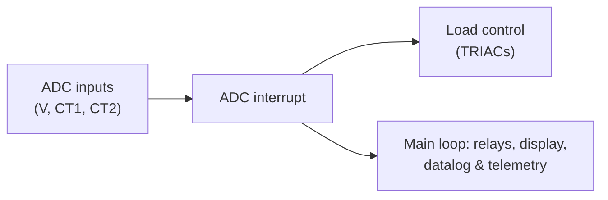

# Firmware Documentation

Technical documentation of the router firmware, and guides for some settings. The settings
themselves are described in [Readme.en.md](../Readme.en.md).

## Design

- **[Software Architecture](architecture.md)** - the boards, the ADC interrupt and its cycle tasks, the main loop, the headers
- **[Configuration System](configuration.md)** - how the settings reach the code, and what the build checks
- **[Performance Characteristics](performance.md)** - ADC interrupt timing, the ADMUX deadline, the main loop
- **[Memory Layout](memory-layout.md)** - flash and RAM use

## Guides

- **[Calibration values](calibration.md)** - where the default values of `calibration.h` come from
- **[Battery systems](BATTERY_CONFIGURATION_GUIDE.en.md)** ([français](BATTERY_CONFIGURATION_GUIDE.md)) - relay thresholds with a home battery
- **[Cloud pattern tuning](https://github.com/FredM67/PVRouter-3-phase/blob/dev/docs/Cloud_Pattern_Tuning_Guide.md)** - choosing `RELAY_FILTER_DELAY` (guide of the 3-phase firmware, same setting)

## Development

- **[Contributing Guide](contributing.md)** - setup, code rules, branches and pull requests
- **[Testing Guide](testing.md)** - native and embedded tests, compile-fail checks, the grid simulator, benchmarks

## Quick reference

- **Boards:** `OLD_SEG`, `OLD_OLED` and `NEW` (`PCB_VERSION`), each with its analog inputs and ADC reference (`adc_chain.h`)
- **ADC sampling:** one conversion every 104 µs (9.6 kHz), voltage, CT1 (grid) and CT2 (diverted) in turn: 64 sample sets per mains cycle at 50 Hz
- **Control:** the loads are decided at mid-cycle on the predicted energy (`fast_control.h`)
- **ADC interrupt:** 243 cycles on average on `NEW`, 347 on `OLD_SEG`, of the 1664 cycles of a conversion ([performance.md](performance.md))
- **Compile-time checks:** every setting is checked by `validation.h`
- **Sensor data:** DS18B20 readings are checked (CRC, range, power-on value, `ds18b20.h`)
- **Polarity:** the voltage polarity is confirmed before it counts (`processing.cpp`)
