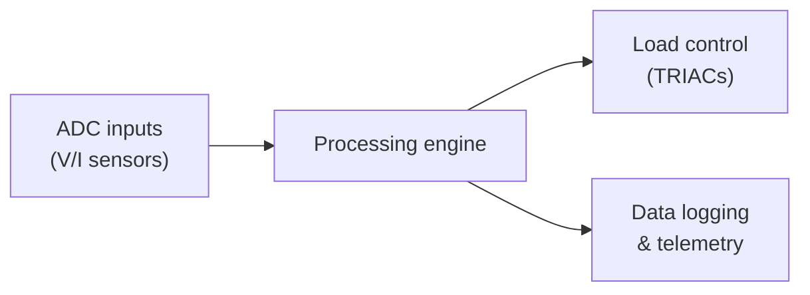

# Architecture Documentation

This directory contains technical documentation about the PVRouter's software architecture, performance characteristics, and design decisions.

> [!NOTE]
> These pages come with the 3-phase firmware this one derives from. The code snippets illustrate the principles; the source files are the reference. In the single-phase firmware, `NO_OF_PHASES` is 1 and the ADC converts three channels: the voltage, CT1 (grid) and CT2 (diverted).

## The single-phase firmware in short

- **Boards** (`PCB_VERSION`): `OLD_SEG`, Robin's Mk2 board (V A3, CT1 A5, CT2 A4, AVcc reference, 7-segment display); `OLD_OLED`, the second old board (V A0, CT1 A1, CT2 A3, AVcc, OLED); `NEW`, the universal board in single-phase mode (V A0, CT1 A1, CT2 A3 on the L2 current input, internal 1.1 V, OLED). A0 to A5 cannot be used for any feature.
- **Sampling**: V → CT1 → CT2 in a fixed chain, free-running, each channel about every 312 µs (64 sample sets per cycle at 50 Hz). The ADMUX written in the interrupt applies to the conversion after next (`adc_chain.h`).
- **Control**: Robin Emley's fasterControl (`fast_control.h`): prediction at the first sample set of the negative half cycle, decision at its index 3, loads switched at the next positive zero crossing.
- **CT2**: pass the wires of every local output, TRIACs and relays, through it. The diverted energy (`diverted_energy.h`) is not counted while a load is forced; the IoT frames carry it as `D` (W) and `E` (Wh), next to `D1`…`Dn`, the ON time of each load.
- **Displays** (`TYPE_OF_DISPLAY`): the 7-segment display of `OLD_SEG`, with (`SEG_HW`) or without (`SEG`) its pin-saving chips, refreshed from the ADC interrupt, or the OLED (U8x8) of `OLD_OLED` and `NEW`, refreshed from the loop.
- **CT1 filter** of the old boards (`ct_filter.h`, `lpf_gainOldBoard` 9, `alphaOldBoard` 0.0011): interim values, to be measured per CT type; off on the new board.

## Documents

### Core Architecture
- **[Software Architecture](architecture.md)** - Overall system design and module relationships
- **[Memory Layout](memory-layout.md)** - RAM and Flash usage analysis
- **[Performance Characteristics](performance.md)** - Timing analysis and benchmarks

### Technical Details
- **[Interrupt System](interrupts.md)** - ADC processing and ISR design
- **[Power Calculation Engine](power-calculation.md)** - Real power measurement algorithms
- **[Configuration System](configuration.md)** - Compile-time validation and type safety

### Development Guides
- **[Contributing Guide](contributing.md)** - How to contribute to the project
- **[Testing Guide](testing.md)** - Testing methodologies and tools
- **[Debugging Guide](debugging.md)** - Troubleshooting and diagnostic techniques

## Quick Reference

### System Overview

### Key Performance Metrics
- **ADC Sampling**: ~104μs per conversion (9.6 kHz), three channels, ~312μs per sample set
- **Memory Usage**: about 20% RAM and 32% flash for the shipped `config.h`, about 42% RAM and 71% flash with the OLED (Arduino Uno; the CI build job reports each build)
- **Real-time Processing**: Zero missed cycles
- **Temperature Resolution**: 0.01°C
- **Power Accuracy**: <1% with proper calibration

### Safety Features
- ✅ Compile-time configuration validation
- ✅ Bounds checking for all array accesses
- ✅ Watchdog monitoring
- ✅ Polarity detection and confirmation
- ✅ Temperature range validation
- ✅ CRC verification for sensor data

For detailed information, see the individual documentation files.
