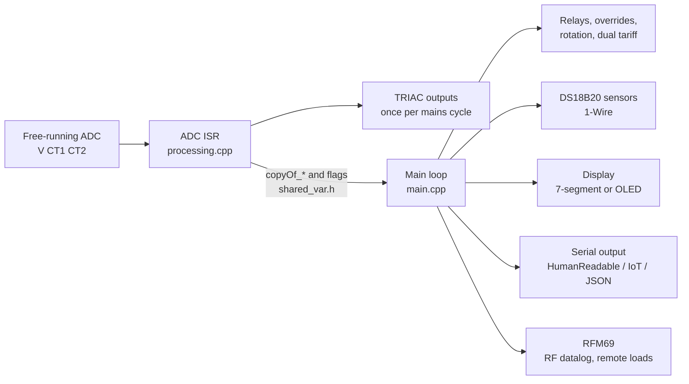

# Software Architecture

How the firmware is organized: the ADC interrupt that measures and switches, the main loop that
does the rest, and the headers each part lives in. The firmware is for one phase and the
ATmega328P only: the ADC chain has three conversions (voltage, CT1, CT2), and the ISR, the ADMUX
values and the port writes are specific to that chip. It derives from the 3-phase firmware
(PVRouter-3-phase), with the same settings and file names; its control core, CT2, the displays
and the old boards are its own.

## Overview

## Boards

`PCB_VERSION` in `config.h` selects the analog inputs and the ADC reference (`adc_chain.h`):

| `PcbVersion` | Voltage | CT1 (grid) | CT2 (diverted) | Reference |
|---|---|---|---|---|
| `OLD_SEG` | A3 | A5 | A4 | AVcc |
| `OLD_OLED` | A0 | A1 | A3 | AVcc |
| `NEW` | A0 | A1 | A3 | internal 1.1 V |

`OLD_SEG` reads its CTs on A4/A5, so it cannot have the OLED (I2C); the 7-segment display only
exists on `OLD_SEG` (`validation.h`).

## The ADC interrupt

The ADC runs free, one conversion every 104 µs (1664 CPU cycles), through a fixed chain of three
channels: V, CT1, CT2; each channel comes back about every 312 µs, 64 sample sets per mains cycle
at 50 Hz (`adc_chain.h`, `config_derived.h`). The firmware has one interrupt, `ISR(ADC_vect)` in
`processing.cpp`:

1. it reads `ADC` (left-adjusted);
2. it calls `processVoltageRawSample()`, `processCurrentRawSample()` (CT1, then the 7-segment
   refresh when that display is fitted) or `processDivertedCurrentRawSample()` (CT2, then one
   pending cycle task);
3. it writes ADMUX last, for the conversion after next (the next one has already started);
4. it steps to the next entry of a circular list of three constant entries (`_channels`).

### The control core

Robin Emley's fasterControl (`fast_control.h`): at the first sample set of the negative half
cycle, the energy at the end of the cycle is predicted from the average power of the first half;
at sample set `DECISION_SAMPLE` (3) of the negative half, the loads are decided on that prediction
(`load_priorities.h`); the zero-crossing triac drivers switch them at the next positive zero
crossing. The prediction uses a per-sample calibration table: no division in the interrupt.

### The work of the mains cycle

The voltage call at a zero crossing only takes what must be taken on that sample (the sums of
the cycle or of the first half, the datalog sums at the end of a period). The rest is posted as
`CycleTask` bits, and each following CT2 call runs one of them (`runNextCycleTask()`): the
cycle's energy into the bucket, the CT2 energy, the datalog sum, at the end of a datalog period
the copies for the main loop (`processDataLogging()`), the prediction, the decision, the load
states and the ports. This keeps every call short enough to write ADMUX in time, even when it
starts late after a 1-Wire time slot. The 3-phase firmware keeps that work in the call of the
crossing.

### Diverted energy (CT2)

With `DIVERTED_CT_PRESENT`, CT2 passes the wires of every local output, TRIACs and relays. Its
energy per mains cycle is added to the diverted energy, in Wh (`diverted_energy.h`), when it
reaches `ANTI_CREEP_LIMIT` (W); the cycles during which a local load or relay is forced are not
counted; the total is reset after `DISPLAY_SHUTDOWN_IN_HOURS` without diversion. The IoT output
carries it as `D` (W) and `E` (Wh).

### CT1 filter (old boards)

`ct_filter.h`: a low-pass of the grid current added back with a gain, in fixed point, with the
`lpf_gain` and `alpha` of `calibration.h` (off on `NEW`).

The interrupt has no floating point, no allocation and no busy-wait. Its timing, and the ADMUX
deadline, are in [performance.md](performance.md).

## The main loop

`loop()` in `main.cpp` reads the flags of `shared_var.h`:

- `b_newMainsCycle`, once per mains cycle, set by the `DATALOG_SUM` cycle task: with temperature
  sensing, one 1-Wire transaction first (`runTemperatureTransaction()`, `temp_schedule.h`); then,
  once per second, the per-second tasks (`handlePerSecondTasks()`: watchdog pin, dual tariff,
  router OFF and diversion pins, override pins and scheduled boosts, relays, load priorities and
  rotation) and the display (`updateDisplay()`);
- `b_datalogEventPending`, once per datalog period: power and voltage from the `copyOf_*` copies,
  the relays' average, the temperatures, and the output (`sendResults()`).

On every pass it also writes the serial output in progress without waiting, and sends the RF
frames of the remote loads. The main loop passes back to the ISR, through `shared_var.h`, which
outputs are forced and whether diversion is on.

## Displays

`TYPE_OF_DISPLAY`: `NONE`, `SEG` or `SEG_HW` (the 7-segment display of `OLD_SEG`, without or with
its pin-saving chips), or `OLED` (U8x8). The 7-segment display is multiplexed from the ADC
interrupt, on the CT1 call; the loop prepares its content once per second (`utils_display.h`).
The OLED is written from the loop, only when its value changes: the I2C transfer of the large
digits takes about 20 ms (`utils_oled.h`). What is shown when is in `display_core.h`.

## Configuration

`config.h` holds the settings, `config_derived.h` builds what the code uses from them, and
`validation.h` checks them at compile time: see [configuration.md](configuration.md).

## Headers

| Header | Content |
|---|---|
| `processing.cpp/.h` | The ADC interrupt and the processing engine, the cycle tasks |
| `adc_chain.h` | The three channels of each board and the ADMUX pipeline |
| `fast_control.h` | The prediction and the decision at mid-cycle |
| `energy_bucket.h` | Integer arithmetic of the energy bucket |
| `diverted_energy.h` | The diverted energy measured on CT2 |
| `ct_filter.h` | The CT1 filter of the old boards (settings in `calibration.h`) |
| `datalog_math.h`, `sample_sets.h` | Integer power and RMS voltage of the datalog; the counter of its sample sets |
| `load_priorities.h` | Which load to switch at each mains cycle |
| `load_map.h` | The load map: one packed byte per load, local or remote |
| `rotation_groups.h` | The loads that take turns at the top of the priorities |
| `override_masks.h`, `utils_override.h`, `pin_edges.h` | Forced outputs: override pins and scheduled boosts; edges of the input pins |
| `dualtariff.h`, `utils_dualtariff.h` | Off-peak period and the windows of the scheduled boosts |
| `relay_engine.h`, `utils_relay.h` | Relay decisions (thresholds, minimum times, settle time, TEMA average); the relay pins and printing |
| `ewma_avg.hpp` | The EMA, DEMA and TEMA averages |
| `remote_loads.h`, `remote_loads_core.h`, `utils_rf.h`, `config_rf.h` | RFM69: RF datalog and remote loads |
| `utils_temp.h`, `ds18b20.h`, `onewire_search.h`, `temp_schedule.h` | DS18B20 sensors: reading, checks, ROM search, scheduling of the 1-Wire transactions |
| `display_core.h`, `utils_display.h`, `utils_oled.h` | The display: content and pins; the 7-segment display; the OLED |
| `serial_output.h`, `teleinfo.h`, `utils.h` | Non-blocking serial output, the IoT frame; the startup configuration and the datalog output (`sendResults()`) |
| `debug.h` | Text output: `info()` (startup configuration, every output mode), `status()` (human-readable output only), `debug()` (only with `ENABLE_DEBUG`) |
| `shared_var.h` | The variables shared by the ISR and the main loop |
| `utils_pins.h`, `utils_bits.h` | Direct port access, bit helpers |
| `mult_asm.h`, `FastDivision.*` | Assembly multiplications and divisions |
| `config.h`, `config_types.h`, `config_system.h`, `config_derived.h`, `calibration.h`, `validation.h` | Configuration |

The Arduino-free headers are tested on the PC; see [testing.md](testing.md).
