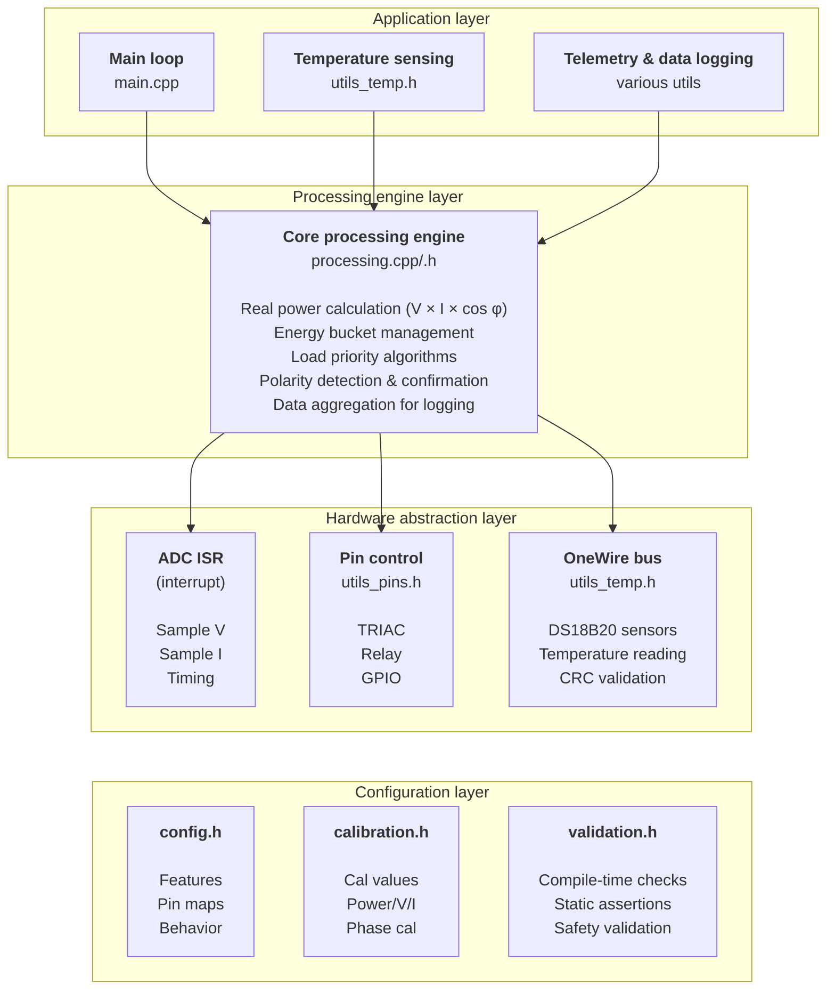

# Software Architecture

This document describes the software architecture of the PVRouter system, including module organization, data flow, and key design decisions.

## System Overview

The PVRouter is designed as a real-time embedded system with the following core responsibilities:

1. **Real-time power measurement** at the grid connection (CT1), and of the diverted power (CT2)
2. **Intelligent load switching** based on surplus energy
3. **Temperature monitoring** for load management
4. **Remote control and monitoring** capabilities
5. **Data logging and telemetry** for analysis

## Architecture Diagram



## Key Modules

### 1. Processing Engine (`processing.cpp/.h`)
**Core responsibility**: Real-time power measurement and load control

**Key functions**:
- `processCurrentRawSample()` - Process current sensor ADC samples
- `processVoltageRawSample()` - Process voltage sensor ADC samples
- `processRawSamples()` - Main ADC sample processing
- `updatePhysicalLoadStates()` - Control TRIAC outputs
- `processDataLogging()` - Aggregate data for logging

**Design patterns**:
- Interrupt Service Routine (ISR) for real-time processing
- Energy bucket algorithm for load switching decisions
- State machine for polarity detection

### 2. Configuration System (`config.h`, `config_types.h`, `config_derived.h`, `validation.h`)
**Core responsibility**: Compile-time configuration and validation

config.h holds the settings only, written with the types of config_types.h; config_derived.h,
which the code includes, builds the derived values and objects from them (see configuration.md).

**Key features**:
- Template-based configuration
- Compile-time validation with `static_assert`
- Type-safe pin assignments
- Feature toggles with zero runtime overhead

**Example validation**:
```cpp
static_assert(check_pins().unique, "******** Duplicate pin definition ! ********");
static_assert(NO_OF_DUMPLOADS > 0, "Number of dump loads must be greater than 0");
```

### 3. Temperature Sensing (`utils_temp.h`)
**Core responsibility**: DS18B20 temperature sensor management

**Key features**:
- Template-based sensor configuration
- Compile-time bounds checking: `readTemperature<INDEX>()`
- Runtime bounds checking: `readTemperature(index)`
- CRC validation and error handling
- The firmware reads the sensors in transactions of its own (`startRead()`, `readScratchpad()`, `endRead()`), one per mains cycle, scheduled by `temp_schedule.h` (Arduino-free, native tests)

### 4. Utility Modules
- **`utils_pins.h`**: Direct port manipulation for performance
- **`utils_relay.h`**: Relay-based load control: the pins and the printing
- **`relay_engine.h`**: The decisions of the relays: thresholds, minimum ON/OFF times, settle time, order, EWMA average (Arduino-free)
- **`utils_dualtariff.h`**: Off-peak period management and the windows of the scheduled boosts (Arduino-free, `constexpr`)
- **`utils_rf.h`**: RF communication support

## Data Flow

### 1. ADC Sampling (9.6 kHz)
```
ADC Interrupt → processRawSamples() → Update running calculations
     ↓
V/I samples → Real power calculation → Energy bucket update
     ↓
Load switching decisions → TRIAC control → Physical load changes
```

### 2. Main Loop (Background)
```
Temperature reading → Sensor validation → Data storage
     ↓
User input processing → Control logic → State updates
     ↓
Data logging → Serial output → Telemetry transmission
```

## Memory Architecture

### Flash Memory Usage (27.8% on Arduino Uno)
- **Code**: ~7.5KB (Processing engine, utility functions)
- **Constants**: ~1.0KB (Calibration, configuration tables)
- **Strings**: ~0.5KB (Debug messages, validation text)

### RAM Usage (26.3% on Arduino Uno)
- **Global variables**: ~300 bytes (Shared state, accumulators)
- **Local variables**: ~150 bytes (Stack usage)
- **Buffers**: ~88 bytes (Temperature scratchpad, arrays)

### Key Memory Optimizations
1. **No dynamic allocation** - All memory statically allocated
2. **Compile-time constants** - `constexpr` eliminates runtime overhead
3. **Efficient data types** - `uint16_t` where `uint32_t` not needed
4. **Shared buffers** - Reuse static buffers for temporary data

## Real-Time Guarantees

### Interrupt Service Routine (ISR)
- **Execution time**: 318 cycles (~20μs) on average, ~58μs for the longest steady-state call; every call must end within one ADC conversion (104μs) - see [performance.md](performance.md)
- **Frequency**: 9.6 kHz (every 104μs)
- **Priority**: Highest (hardware ADC interrupt)
- **Memory**: Stack-based, no heap allocation

### Critical Timing Requirements
1. **ADC processing**: Must complete within 104μs
2. **TRIAC switching**: Synchronized to mains zero-crossing
3. **Temperature conversion**: 750ms maximum (DS18B20 limit)
4. **Serial communication**: Non-blocking, buffered output

## Error Handling Strategy

### Compile-Time Safety
- Static assertions for configuration validation
- Template bounds checking for array access
- Type safety with strong typing (enums, constexpr)

### Runtime Error Handling
- CRC validation for sensor data
- Range checking for temperature readings
- Polarity confirmation for power calculations
- Watchdog monitoring for system health

### Graceful Degradation
- Continue operation if temperature sensors fail
- Disable loads if voltage/current sensors malfunction
- Maintain basic power measurement if advanced features fail

## Performance Characteristics

### Computational Efficiency
- **Real power calculation**: 16-bit integer arithmetic
- **Phase correction**: Linear interpolation
- **Load switching**: Energy bucket algorithm (O(1) complexity)

### Memory Efficiency
- **Zero-copy data flow**: Direct ADC → calculation → output
- **Minimal buffering**: Only essential data stored
- **Compile-time optimization**: Templates eliminate runtime overhead

### Power Efficiency
- **Minimal sleep usage**: Interrupt-driven design
- **Efficient algorithms**: Optimized for AVR instruction set
- **Low-power modes**: Available for battery applications

## Single-phase specifics

- **Sampling chain** (`adc_chain.h`): V → CT1 (grid) → CT2 (diverted), free-running, ~104 µs per conversion, ~312 µs per sample set. When the interrupt of a conversion runs, the next conversion has already started with the previous ADMUX: the interrupt writes the channel two steps ahead. Each board has its analog inputs and its reference (AVcc on the old boards, internal 1.1 V on `NEW`).
- **Control core** (`fast_control.h`, `processing.cpp`): Robin Emley's fasterControl, that of `Mk2_fasterControl_twoLoads_5`. At the first sample set of the negative half cycle, the bucket level at the end of the cycle is predicted from its level at the start and the average power of the first half (through a per-sample calibration table: no division in the interrupt). At sample set index 3 of the negative half, the loads are decided on that prediction; the zero-crossing triac drivers switch them at the next positive zero crossing.
- **Once-per-cycle work** (`CycleTask` in `processing.cpp`): the work of the mains cycle (diverted energy, datalog sums, load states) is spread over the CT2 calls that follow the zero crossings, so that no interrupt call needs more than ~420 cycles to reach its ADMUX write, even when entered late after a 1-Wire time slot.
- **Temperature transactions** (`temp_schedule.h`, `runTemperatureTransaction()` in `main.cpp`): the loop runs the 1-Wire I/O one short transaction per mains cycle, started as soon as it sees the new cycle (`b_newMainsCycle`, set once the work after the positive crossing is done): the slots that keep the interrupts off (resets, 0s written) fall among the ordinary interrupt calls of the positive half, not on the heavier ones of the zero crossings. A round per datalog period: the conversion, then 3 transactions per sensor.
- **Diverted energy** (`diverted_energy.h`): CT2 power per cycle, accumulated in Wh with an anti-creep limit (`ANTI_CREEP_LIMIT`, in W), not counted while a load is forced, reset after `DISPLAY_SHUTDOWN_IN_HOURS` without diversion.
- **CT1 filter** (`ct_filter.h`): Robin's IIR low-pass of the grid current, added back with a gain, in fixed point (~210 cycles instead of ~1100 with floats). Old boards only; interim values.
- **Displays** (`display_core.h`, `utils_display.h`, `utils_oled.h`): the 7-segment display multiplexed from the ADC interrupt (one port image per digit, prepared by the loop), or the OLED written from the loop (about 20 ms per redraw, only when the value changes).

## Extension Points

### Adding New Features
1. **New sensor types**: Extend template system in utils_temp.h
2. **Additional loads**: Modify NO_OF_DUMPLOADS and arrays
3. **Communication protocols**: Add new utils_*.h modules
4. **Control algorithms**: Extend processing engine

### Hardware Adaptations
1. **Different microcontrollers**: Modify pin definitions
2. **3-phase sites**: use the 3-phase firmware (PVRouter-3-phase), whose settings and file names this firmware shares
3. **Different ADC resolution**: Adjust calibration factors
4. **Custom hardware**: Implement new utils modules

This architecture provides a solid foundation for embedded real-time power management while maintaining extensibility and safety.
